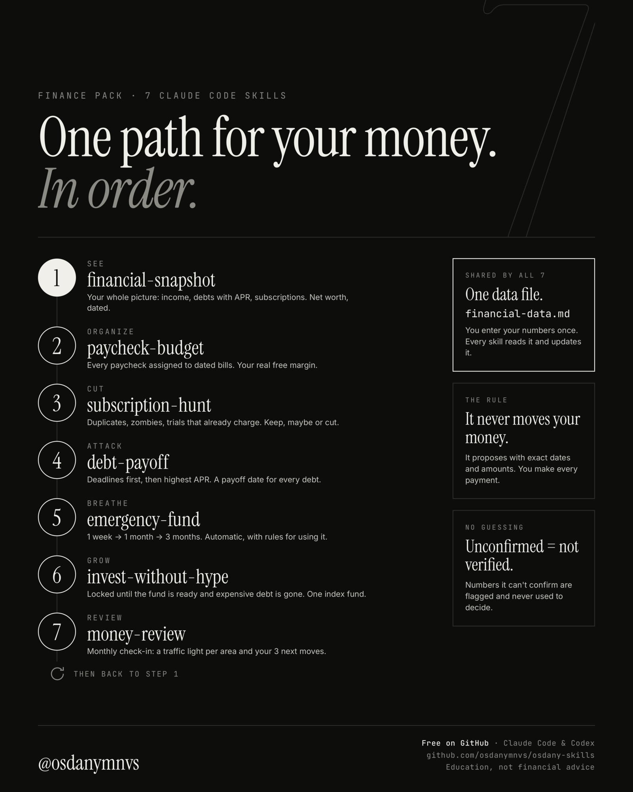

# Finance pack — 7 skills for Claude Code and Codex

> **Disclaimer.** This is general financial education, not personalized financial advice. The skills never move money or log into your accounts: they propose, and you decide and act. Confirm decisions with serious consequences (taxes, investing, credit) with a licensed professional in your country.

A system, not seven loose prompts: **the full path of a person's money, in order**. Each skill does one phase and hands the work to the next. They all read and write the same data file, `financial-data.md`, so you enter your numbers once.

**The path: See → Organize → Cut → Attack → Breathe → Grow → Review**

| # | Skill | What it does | Needs first |
|---|-------|--------------|-------------|
| 1 | `financial-snapshot` | The diagnosis: builds your full picture (income, accounts, debts with APR and due dates, money held for others, subscriptions) and creates `financial-data.md`. Dated net worth. | Nothing. It's the entry point. |
| 2 | `paycheck-budget` | A budget built on your real pay cycle: every paycheck assigned to dated payments, sinking funds for irregular costs and your true free margin. | The snapshot (1) |
| 3 | `subscription-hunt` | Audits subscriptions and recurring charges: duplicates, zombies, trials that already charge. Each one KEEP / MAYBE / CUT, with the annual saving and cancellation steps. | The snapshot (1) |
| 4 | `debt-payoff` | The attack strategy: money-saving deadlines first, then avalanche by cost, a paycheck-by-paycheck calendar and the payoff date of every debt. | The snapshot (1) |
| 5 | `emergency-fund` | The safety net in levels (1 week → 1 month → 3 months of expenses), automatic contribution per paycheck and rules for using and refilling it. | The budget (2) |
| 6 | `invest-without-hype` | Your first investment, behind a hard gate: it only opens with the fund at Level 1 and no high-APR debt. Retirement account, one index fund, automatic contribution, anti-hype rules. | Fund at Level 1 (5) |
| 7 | `money-review` | The monthly or quarterly ritual: new snapshot vs. the last one, a traffic light per area and the 3 moves for the next period. Closes the loop and goes back to 1. | Having run the pack |

## Rules all 7 share

- **One data file** (`financial-data.md`) with fixed sections: Income · Accounts and balances · Debts · Money held for others · Subscriptions and recurring · Fixed expenses · Emergency fund · Investing · Snapshot history.
- **Totals always kept apart**: your own debts / money you hold for someone else (it isn't yours and it isn't debt) / recurring costs. Never added together.
- **Verify before stating**: anything not confirmed is marked NOT VERIFIED and isn't used to decide.
- **None of them moves money**: they propose with exact dates and amounts; you make every payment, cancellation or contribution.
- **Dated outputs** and plain, step-by-step language.

## Install

1. Copy the 7 folders into `~/.claude/skills/` (Claude Code) or `~/.agents/skills/` (Codex).
2. Create a project folder for your finances and open it in Claude Code.
3. Run `/financial-snapshot` first (or just say "do my financial snapshot"): it creates the data file and the path continues from there.

Want to see what the data file looks like? There's one with fictional numbers in [`examples/financial-data.example.md`](examples/financial-data.example.md).

Prefer Spanish? The original version is in [`/es/finance-pack`](../es/finance-pack).
